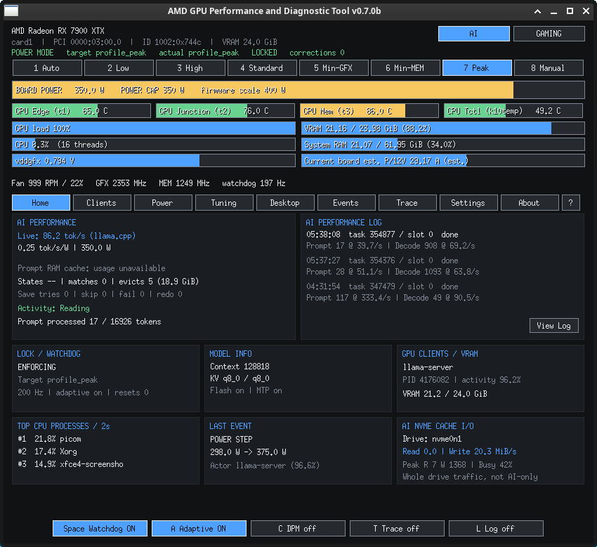
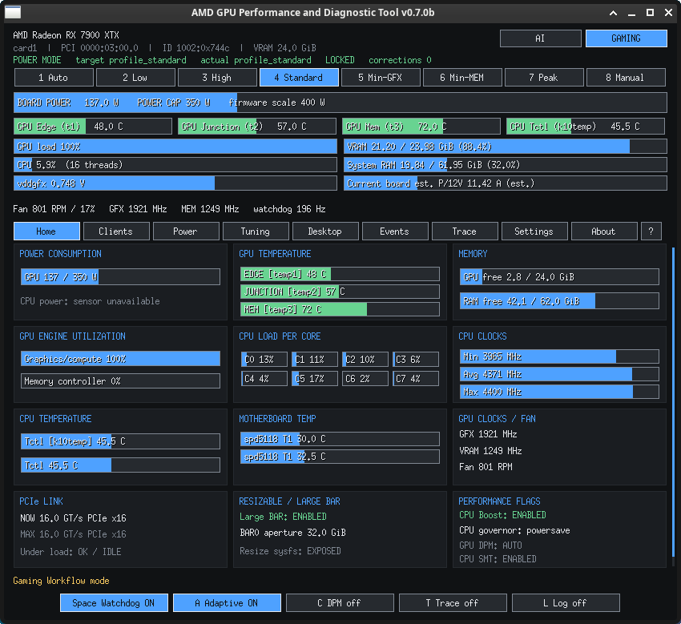

# AMD GPU Diagnostic Tool

[](https://github.com/kevito666/amd-gpu-diag-tool/actions/workflows/ci.yml?query=branch%3Amain)
[](https://github.com/kevito666/amd-gpu-diag-tool/actions/workflows/ci.yml?query=branch%3Arefactor%2Fv0.8.0)


I originally wrote this to deal with AMD GPU power states and coil whine on Linux. It kept growing: clocks, temperatures, power, PCIe, desktop/compositor diagnostics, then AI and gaming monitoring. It's now a little C/Xlib control panel for figuring out what the GPU is *actually* doing.

Built in Tohoku, Japan. Native C, X11/XLibre, no GTK/Qt/Electron stack. Data comes from Linux's AMDGPU, sysfs, procfs, DRM, and related interfaces. Some controls write to the driver, so **read the safety notes before using it as root**.

## Which version?

| | Version | What it means |
|---|---|---|
| **`main`** | **v0.7.0b** + a compiler portability fix | Published beta source; conservative default |
| **[`refactor/v0.8.0`](https://github.com/kevito666/amd-gpu-diag-tool/tree/refactor/v0.8.0)** | **v0.8.0-dev.16** | Current development code, not a release |
| **[Releases](https://github.com/kevito666/amd-gpu-diag-tool/releases)** | **v0.7.0b** | Latest tagged release; tag is unchanged |

The v0.8.0 branch is where the active work is happening. Its [README](https://github.com/kevito666/amd-gpu-diag-tool/blob/refactor/v0.8.0/README.md) has the current feature details, and both branches have their own CI status above.

## What it monitors

- **GPU:** edge/junction/memory temperatures when exposed, utilization, clocks, voltage/current/power, DPM and power profiles, limits and watchdog corrections.
- **Linux/desktop:** PCIe link and BAR information, GPU clients, desktop/session/compositor details, DRM display modes and available VRR state.
- **Gaming:** GPU and system telemetry in one view. This is **not** an FPS counter unless an actual frame source is available.
- **Local AI:** llama.cpp/Bionic task timing, supported Project Maya engine logs, and selected NVMe-device read/write rates. NVMe readings are for the **whole drive**, not just the model process.
- **Controls:** power-policy management and guarded tuning actions, with the firmware's reported ranges taking precedence. Colored warnings are not a safety certificate.

Some readings depend on the driver, permissions, and which interfaces your card actually exposes. Missing information is shown as unavailable rather than made up.

## Screenshots

Actual **v0.7.0b** captures from an RX 7900 XTX. These show real readings at one point in time, not benchmark results or dev.16 screenshots.

| AI / local inference | Gaming / hardware |
|:---:|:---:|
|  |  |

## What's happening on v0.8.0?

The work on [`refactor/v0.8.0`](https://github.com/kevito666/amd-gpu-diag-tool/tree/refactor/v0.8.0) isn't just a version-number change:

- Broke the old monolithic C source into GPU, monitoring, AI, UI, diagnostics, and settings modules.
- Moved slow read-only system/AI and GPU-client/desktop discovery work to **two background workers**. GPU control writes still go through one synchronous path.
- Added more useful watchdog timing diagnostics, including actual check-to-check gaps, for comparing idle and heavy AI workloads.
- Cleaned up Tuning and Settings: two-column Settings layout, a read-only Radeon reference database browser, larger GPU title, and separate About/Help navigation.
- Kept the same settings format and existing ARM/APPLY/RESET safeguards.

**Not done yet:** mouse-dragging the scrollbars (wheel scrolling works), hardware-based watchdog performance comparison, and final multi-GPU/tuning validation. No claim of hard real-time 5 ms enforcement.

## Build

You'll need a C compiler, `make`, X11 development headers, libcurl development headers, and X11 runtime libraries. The headless UI tests also need `xvfb-run` and `xauth`.

```sh
git clone https://github.com/kevito666/amd-gpu-diag-tool.git
cd amd-gpu-diag-tool
make -j"$(nproc)"
make check check-config check-parser check-pcie check-audit check-maya-nvme check-ui
./amd-gpu-diagnostic --version
```

To build the **current development branch** instead:

```sh
git switch refactor/v0.8.0
make clean && make -j"$(nproc)"
make check check-ui
```

See the [development README](https://github.com/kevito666/amd-gpu-diag-tool/blob/refactor/v0.8.0/README.md) for the larger module-test suite and timing capture scripts.

### Root access and GPU writes

The existing power-policy and tuning paths require elevated privileges on the supported setup. Review the source before running something with `sudo`; `sudo -E ./amd-gpu-diagnostic` preserves the relevant desktop environment on many setups but depends on your sudo/X11 configuration.

Switching GPUs pauses enforcement and disarms tuning. It **does not automatically restore** the previous GPU's power policy. The overclock-unlock option remains a placeholder, not a working overclock feature. Test any write controls on your own hardware and know how to restore stock settings.

CI covers strict C builds, hardware-free module tests, and virtual-X11 UI checks. That's useful, but it isn't proof that every driver/card combination is safe or that watchdog timing is real-time under load.

## Issues, source and license

If something is wrong, [open an issue](https://github.com/kevito666/amd-gpu-diag-tool/issues) with the AMD GPU model, kernel, driver, desktop session, reproduction steps, and relevant logs. Don't post secrets or sensitive file paths from your AI logs.

Written by **Kevin Kolasa** ([@kevito666](https://github.com/kevito666)) in Tohoku, Japan. Licensed **GPL-3.0-or-later**; see [LICENSE](LICENSE). Detailed technical notes are in [`docs/`](docs/).
