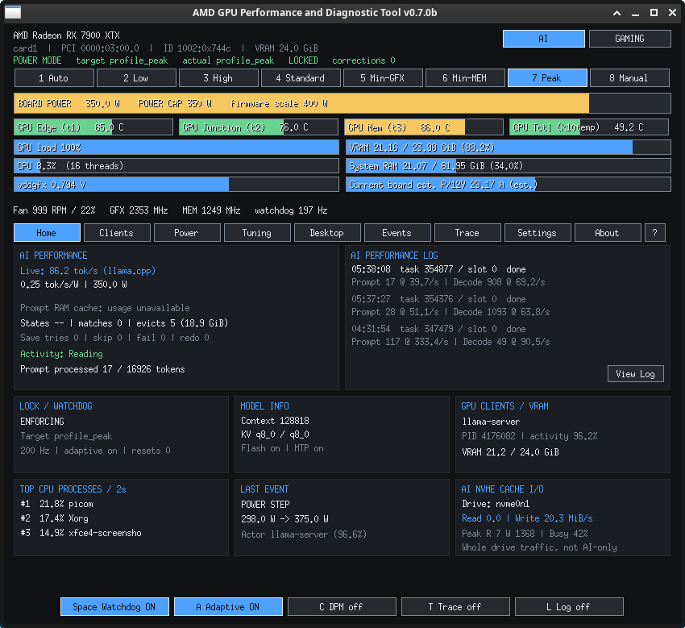
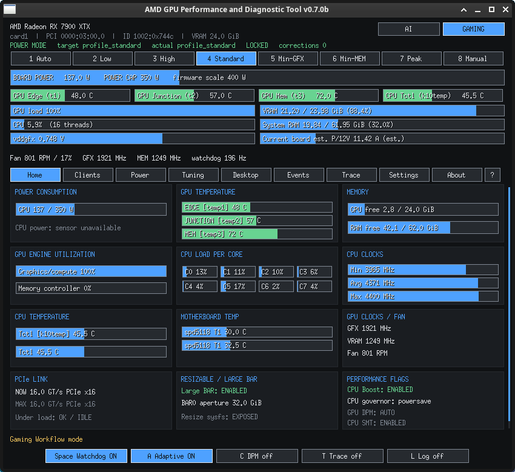

# AMD GPU Performance and Diagnostic Tool

**Version 0.7.0b (beta) · GPL-3.0-or-later · C / Xlib / AMDGPU · X11/XLibre**

What started as a coil-whine reducer and GPU power-state controller morphed into a full-blown AI and gaming desktop monitoring and configuration tool. Built in **Tohoku, Japan**.

A lightweight X11/XLibre-first diagnostics utility for Linux AMD GPUs. No GTK, Qt, Electron or Python runtime. Uses the kernel's sysfs, procfs, debugfs, tracefs and DRM fdinfo interfaces and an Xlib desktop UI. It currently requires root for its existing AMDGPU power-policy writes. **Review the code before running with sudo.**

## Screenshots — v0.7.0b running on AMD Radeon RX 7900 XTX

These are unmodified captures of the actual compact X11 interface, not simulated mockups. Hardware and AI readings are momentary observations, not benchmark results.

| AI monitoring | Gaming monitoring |
|:---:|:---:|
|  |  |

The **AI** screenshot shows task-specific prompt/decode timing entries and the selected NVMe monitoring tile. The dashboard supports llama.cpp/Bionic timing logs and selectable Project Maya log parsing. **AI NVMe CACHE I/O** measures aggregate I/O on the selected NVMe namespace; it cannot identify which requests or processes generated the disk traffic. The **Gaming** dashboard reports AMDGPU and Linux hardware telemetry, not game-rendered FPS unless a real frame source is connected.

## Build and run (Arch Linux / X11)

Install a C compiler, `make`, X11 headers, libcurl development headers and X11 runtime. To build:

```sh
make
make check check-config check-parser check-pcie check-audit check-maya-nvme check-ui
sudo make install
sudo -E /usr/local/bin/amd-gpu-diagnostic
```

The visual smoke tests need `xvfb-run` and `xauth`. Running the program without root is not supported for GPU power-policy tuning. `--version` and `--help` work without root. `--card N` chooses a DRM card on startup and overrides the saved preference for that invocation.

## Screens and actions

- **AI / GAMING** workflow buttons select the main dashboard.
- **Settings** contains AI token/API/Project Maya log source, AI log parser, Auto/Manual log detection with an editable absolute filename, a saved AI NVMe device selector, compositor source, detected AMD card selector and an inert overclock unlock placeholder.
- **Power** contains power, voltage, current, power caps, equivalent load estimates, power profile and policy. GPU thermals, clocks and VRR are under Gaming/Desktop.
- **Tuning** has compact 3×2 tiles, firmware-range labels, and a 2×2 ARM/APPLY/RESET/REFRESH group inside the safety tile. RESET STOCK is available; do not confuse colored zones with safety certification.
- **Desktop** reports session, X server, desktop, window manager, compositor, their installed Arch package versions and package build dates where known, plus DRM modes/refresh/VRR and explicitly unverified VSync/buffering.
- **Events** shows the 15 most recent significant events it still retains, leaving high-frequency GFXOFF/DPM changes out of that *view*. CSV events are unaffected.
- The square **?** opens keyboard and mouse help. **About** contains origin, license and development credits.

### Settings and privilege boundary

Settings persist in `~/.config/amd-gpu-diagnostic/settings.ini` in the **invoking user's** home directory (when started through sudo). Changes are saved atomically by dropping privileges before writing a mode-0600 file. The settings file is local, plain-text, and can be copied between systems; it is not a tuning profile. Editing the log filename accepts a typed absolute path; Enter saves; Esc cancels.

Settings changes do not require a restart. After choosing another AMD card, click **APPLY GPU**. The app opens the new device first, then pauses policy enforcement, clears clock locks and tuning ARM state, and rebinds telemetry. It **does not restore the old GPU's pre-existing policy**. It will not automatically enable the watchdog on the newly selected GPU. Do not switch during an active dangerous tuning session.

### Project Maya + AI NVMe monitoring (pre-beta addition)

The AI dashboard includes a compact **AI NVMe CACHE I/O** tile showing read and write
rates (MiB/s), observed peaks, and approximate device busy percentage from Linux
`/sys/block/nvmeXnY/stat`. Settings > **AI NVME CACHE SSD** cycles detected NVMe
namespaces and shows the kernel's model label. The chosen namespace (e.g. `nvme0n1`)
is saved in the invoking user's `settings.ini` as `ai_nvme_device`. An invalid or missing
device is shown as unavailable, never silently substituted for a different saved device.

**The readings count all I/O on that NVMe namespace, not exclusively Project Maya/DeepSeek
model traffic.** Sampling is approximately every 0.5 seconds, using monotonic elapsed time;
peaks reset upon changing drives or a counter reset. This is a monitoring-only feature;
there is no SSD writes, tuning, stress test, or hardware setting change.

Project Maya produces `maya-<model>.log` beside its model configuration. Select **Project
Maya (log)** for both AI DATA SOURCE and AI LOG PARSER, then choose the log path manually,
or leave discovery set to Auto for supported locations: `~/src/project-maya`,
`~/project-maya`, or `~/Downloads/project-maya`. Project Maya's verified GLM engine
log entries include `glm stat:`, `glm prefill:`, `glm fast:` and `glm split`.
The parser also retains `ds4`-prefixed engine lines without pretending a different
format is compatible. The dashboard shows last reported decode rate, prefill rate
when explicitly available, VRAM expert hit %, RAM fetches per token and SSD reads/
wait time per token when logged. Values are completed log summaries, **not live
per-token measurements**. Missing metrics are labeled unavailable, not inferred.

If Project Maya uses an unusual custom location or log naming, use the **manual absolute
log path** setting. For troubleshooting, the engine log is typically named
`maya-<model>.log` in the Project Maya root. Project Maya supports model
expert tiers spanning GPU VRAM, system RAM and NVMe; the filesystem I/O monitor is
independent of its log parser. Upstream reference:
[Project Maya](https://github.com/mw00/project-maya).

### AI parser notes

The llama.cpp/Bionic task-aware parser is fully implemented, including prompt/eval rates and host-RAM prompt cache messages from a 512 KiB log tail. Other log parser modes are **experimental placeholders**: users can select them, but task timing is not synthesized from unrelated log formats. Ollama/vLLM/LM Studio API token-source detection remains separate from log-file parsing. Prompt cache occupancy is an event-based *last-reported* value, not a sampled RSS reading. The 24 GiB Bionic host cache is separate from GPU VRAM.

### Desktop diagnostics notes

Version and **package build dates** come from local `/var/lib/pacman/local/*/desc` metadata, not a binary compile timestamp. On unsupported distributions the dates may show *unknown*. Display refresh is read from reported DRM CRTC state when debugfs access permits. DRM `vrr_enabled` describes the current kernel-reported state if exposed; it does not verify per-game frame pacing. **VSync/number of buffers cannot be reliably inferred from the compositor process, so they are marked unverified.**

### Known issues / before tagging the beta

- Validate on your RX 7900 XTX with picom/XFCE/XLibre, including the Settings screen's GPU selection and custom Bionic log path.
- Validate a second AMD GPU, if possible, and test the pause/re-arm behavior during switching.
- The code has been built under strict `-Werror` and tested against synthetic X11 telemetry; this does not guarantee safe hardware write behavior across drivers.
- The overclock unlock feature does nothing in this beta by design.


## v0.7.0b stabilization audit

Before the GitHub beta tag, this source package received a correctness and performance pass. The main fixes are: CPU fan file-descriptor/path handling, libcurl authentication lifetime and bounded response buffering, cached `/proc`-based llama-server discovery, strict integer settings parsing, real interval CPU-process activity, and removal of stale/unverified AI rate and debug output. See [`docs/AUDIT_AND_ARCHITECTURE.md`](docs/AUDIT_AND_ARCHITECTURE.md) for tests, architecture and remaining limitations. The current window/tile organization and tuning safeguards are unchanged.

This tarball has a **flat project-root layout** for updating your existing checkout directly. Your previous builds remain in `archive/`, which is excluded from Git. The screenshots above are genuine v0.7.0b captures; they show actual device readings, not synthetic performance claims.

## License

Copyright (C) 2026 Kevin Kolasa. Source and redistribution under **GPL-3.0-or-later**. Full text in `LICENSE`.

### Second-pass pre-release audit

The v0.7.0b source includes a second-pass stability audit, regression tests, and hardware testing checklist in [`docs/DEEP_AUDIT_2.md`](docs/DEEP_AUDIT_2.md). In particular, watchdog enforcement and synchronous telemetry share one event loop: configured microsecond intervals are desired sampling intervals, **not hard real-time guarantees**.

For GitHub release assets, the source package contains a flat root layout; extract into an existing checkout only after backing up local changes. The X11 UI test harness compiles without optimization to keep headless CI responsive; the production binary uses the standard optimized build flags.
